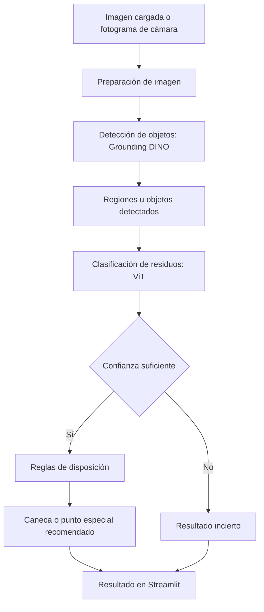
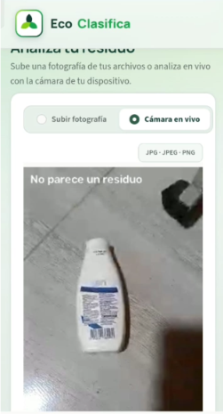

<div align="center">


# EcoClasifica ♻️

**Identifica tus residuos y descubre cómo separarlos correctamente.**

[](https://www.python.org/)
[](https://streamlit.io/)
[](https://pytorch.org/)
[](https://huggingface.co/)
[](https://developer.nvidia.com/cuda-toolkit)
[](./LICENSE)

</div>

---

## Descripción

**EcoClasifica** es una aplicación desarrollada en Python y Streamlit que utiliza visión por computador e inteligencia artificial para detectar y clasificar residuos, y recomendar su correcta separación.

La aplicación contempla dos formas de entrada: cargar una imagen y utilizar la cámara en tiempo real. El sistema combina un detector de objetos **Grounding DINO** con un clasificador de residuos **Vision Transformer (ViT)**. A partir de los resultados, aplica las reglas de disposición configuradas en el proyecto para recomendar una caneca o un punto de recolección especial.

El proyecto utiliza modelos preentrenados y puede aprovechar una GPU NVIDIA mediante CUDA cuando el entorno es compatible.

## Funcionalidades

| Funcionalidad | Descripción |
|---|---|
| Carga de imágenes | Permite seleccionar una imagen para analizarla. |
| Cámara en tiempo real | Recibe fotogramas de la cámara y permite analizarlos de forma continua. |
| Detección de objetos | Grounding DINO localiza objetos candidatos dentro de la imagen. |
| Clasificación de residuos | ViT asigna una categoría de residuo a los objetos que pasan por el proceso de clasificación. |
| Nivel de confianza | Permite consultar las puntuaciones asociadas a las predicciones, según los resultados del modelo. |
| Recomendación de disposición | Relaciona la categoría identificada con la caneca o el punto de recolección correspondiente. |
| Catálogo visual | Presenta las categorías reconocidas y su disposición. |
| Procesamiento con GPU | Puede utilizar CUDA para ejecutar los modelos en una GPU NVIDIA compatible. |

> **Estado de integración:** el módulo de cámara utiliza `streamlit-webrtc` y está diseñado para enviar fotogramas al método de análisis en tiempo real del pipeline. La integración definitiva y la validación de los resultados dependen de la versión final del pipeline y de sus contratos.

## ¿Cómo funciona?

EcoClasifica recibe una imagen cargada por el usuario o un fotograma de la cámara. La imagen se prepara y se envía al proceso de detección. Grounding DINO identifica regiones candidatas; posteriormente, el clasificador ViT permite determinar la categoría del residuo. Finalmente, las reglas del proyecto relacionan la categoría con una recomendación de disposición.



El sistema contempla resultados inciertos cuando la predicción no alcanza los criterios de confianza definidos en la configuración. También puede contemplar imágenes u objetos que no correspondan a residuos, de acuerdo con las reglas implementadas en el pipeline.

## Modelos de inteligencia artificial

### 1. Detector de objetos — Grounding DINO

Modelo utilizado: [`IDEA-Research/grounding-dino-tiny`](https://huggingface.co/IDEA-Research/grounding-dino-tiny).

Grounding DINO se utiliza como detector de objetos: analiza la imagen y localiza regiones que corresponden a las etiquetas candidatas proporcionadas al modelo. Su función en EcoClasifica es encontrar los objetos que posteriormente pueden pasar al proceso de clasificación.

La configuración seleccionada para las pruebas del proyecto es:

| Parámetro | Configuración |
|---|---|
| Modelo | `IDEA-Research/grounding-dino-tiny` |
| Umbral de detección | `0.20` |
| Supresión de cajas duplicadas (NMS) | Global, sin separar por etiqueta |
| IoU de NMS | `0.5` |
| Área máxima de una caja | `70 %` de la imagen |
| Máximo de detecciones | `4` |
| Dispositivo utilizado en las pruebas | GPU CUDA |

La configuración fue seleccionada mediante inspección visual comparativa de los resultados obtenidos con distintos umbrales e imágenes de prueba. Se priorizaron detecciones visualmente más limpias y una reducción de falsos positivos.

**Nota:** el umbral `0.20` es una decisión operativa basada en esas pruebas. No representa una calibración probabilística de los puntajes ni implica que el modelo haya sido reentrenado. Un umbral más alto también puede omitir objetos reales con puntuaciones inferiores.

El registro de esta decisión y el procedimiento de prueba se encuentran en [`docs/gdino_calibration_decision.md`](docs/gdino_calibration_decision.md), y el código de calibración se conserva en [`benchmarks/gdino_calibration_v2.py`](benchmarks/gdino_calibration_v2.py).

### 2. Clasificador de residuos — Vision Transformer (ViT)

Modelo utilizado: [`watersplash/waste-classification`](https://huggingface.co/watersplash/waste-classification).

Es un modelo preentrenado de clasificación de imágenes basado en la arquitectura Vision Transformer (ViT), utilizado para reconocer las categorías de residuos contempladas por el proyecto.

| Característica | Información |
|---|---|
| Arquitectura | Vision Transformer (ViT) |
| Tarea | Clasificación de imágenes |
| Parámetros | 85,8 millones |
| Tipo de pesos reportado | F32 |
| Categorías | 12 |
| Precisión de ejecución reportada en las pruebas | FP32 |
| Resolución de entrada | 224 × 224 píxeles |
| Dataset asociado | [Garbage Classification](https://www.kaggle.com/datasets/mostafaabla/garbage-classification) |

El clasificador recibe la imagen o región que se le proporciona, extrae características visuales y genera puntuaciones para las categorías aprendidas durante su entrenamiento. En EcoClasifica se consideran las predicciones y los criterios de confianza configurados en el proyecto.

**Importante:** el equipo utiliza el modelo preentrenado disponible en Hugging Face; no se presenta como un modelo entrenado desde cero por el equipo.

## Categorías reconocidas

El clasificador contempla 12 categorías, relacionadas con las reglas de disposición implementadas en EcoClasifica.

| Categoría | Etiqueta del modelo | Destino recomendado |
|---|---|---|
| Plástico | `Plastic` | Caneca blanca |
| Metal | `Metal` | Caneca blanca |
| Papel | `Paper` | Caneca blanca |
| Cartón | `Cardboard` | Caneca blanca |
| Vidrio verde | `Green-Glass` | Caneca blanca |
| Vidrio transparente | `White-Glass` | Caneca blanca |
| Orgánico | `Biological` | Caneca verde |
| Residuo vegetal | `Brown-grass` | Caneca verde |
| Basura general | `Trash` | Caneca negra |
| Pila o batería | `Battery` | Punto de recolección especial |
| Ropa | `Clothes` | Punto de recolección especial |
| Calzado | `Shoes` | Punto de recolección especial |

La asignación se basa en las reglas de separación en la fuente adoptadas por el proyecto. Para casos particulares, se debe atender la orientación de los sistemas locales de recolección.

## Cámara en tiempo real

La aplicación incorpora un módulo de cámara basado en [`streamlit-webrtc`](https://github.com/whitphx/streamlit-webrtc), que permite recibir video desde el navegador en lugar de limitarse a capturar una única fotografía.

El módulo procesa fotogramas de video de manera periódica y los envía al método de análisis en tiempo real del pipeline. Para evitar ejecutar la inferencia en cada fotograma, el módulo utiliza un intervalo entre envíos. Los resultados disponibles pueden dibujarse sobre el video mediante cajas delimitadoras, etiquetas y colores asociados al contenedor recomendado.

Características de la implementación:

- Captura de video desde el navegador, con autorización del usuario.
- Procesamiento periódico de fotogramas.
- Ejecución del análisis en un hilo de trabajo separado del procesamiento del video.
- Visualización de las detecciones y sus etiquetas sobre la imagen.
- Comunicación con el pipeline mediante su método de análisis en tiempo real.

La cámara requiere que el navegador tenga permiso para acceder al dispositivo. El funcionamiento desde otros equipos o redes puede depender de la configuración de WebRTC y de la conectividad disponible.

## Interfaz de usuario

La aplicación cuenta con una interfaz desarrollada en Streamlit, organizada mediante componentes reutilizables y estilos personalizados.

Entre sus elementos se encuentran:

- Encabezado y presentación del proyecto.
- Área de carga y visualización de imágenes.
- Acceso a la cámara en tiempo real.
- Panel de resultados de detección y clasificación.
- Catálogo visual de las 12 categorías.
- Recomendaciones de disposición.
- Indicadores visuales de la caneca correspondiente al resultado.

**Vista principal**

<!-- Agregar captura real de la aplicación -->
<p align="center">
  
</p>

**Resultado de clasificación**

<!-- Agregar captura real de una clasificación -->
<p align="center">
  
</p>

**Cámara en tiempo real**

<!-- Agregar captura real de la cámara con detecciones -->
<p align="center">
  
</p>

## Tecnologías utilizadas

| Tecnología | Aplicación en el proyecto |
|---|---|
| Python | Lenguaje principal |
| Streamlit | Interfaz de usuario |
| streamlit-webrtc | Captura y transmisión de video desde el navegador |
| OpenCV | Procesamiento de fotogramas y dibujo de detecciones |
| PyTorch | Ejecución de los modelos |
| Hugging Face Transformers | Acceso a los modelos de visión |
| Grounding DINO | Detección y localización de objetos |
| Vision Transformer (ViT) | Clasificación de residuos |
| CUDA | Aceleración mediante GPU NVIDIA compatible |
| Git y GitHub | Control de versiones y colaboración |

## Instalación y ejecución

### Requisitos

- Python 3.x.
- Git.
- Dependencias indicadas en `requirements.txt`.
- GPU NVIDIA compatible con la versión de PyTorch/CUDA instalada (opcional).
- Cámara y navegador con permisos de acceso, para utilizar el modo en tiempo real.

### 1. Clonar el repositorio

```bash
git clone URL_DEL_REPOSITORIO
cd NOMBRE_DEL_REPOSITORIO
```

### 2. Crear un entorno virtual

```bash
python -m venv venv
```

En Windows:

```bash
venv\Scripts\activate
```

En Linux:

```bash
source venv/bin/activate
```

### 3. Instalar las dependencias

```bash
pip install -r requirements.txt
```

Verifica que `requirements.txt` incluya las dependencias necesarias para Streamlit, `streamlit-webrtc`, PyTorch, Transformers, OpenCV y el procesamiento de imágenes y video utilizadas por el proyecto.

### 4. Ejecutar la aplicación

```bash
streamlit run app.py
```

Streamlit indicará en la terminal la dirección local para abrir la aplicación en el navegador.

## Procesamiento con CUDA

EcoClasifica utiliza PyTorch para ejecutar los modelos y seleccionar el dispositivo disponible según la configuración del proyecto: CPU o GPU NVIDIA compatible con CUDA.

Las pruebas de rendimiento documentadas para el clasificador ViT se realizaron con una NVIDIA GeForce GTX 1650 Ti de 4 GB de memoria.

### Comparación del clasificador ViT

Prueba realizada con una imagen de 1200 × 1200 píxeles, 30 repeticiones y 5 ejecuciones de calentamiento descartadas.

| Configuración | Tiempo de inferencia |
|---|---:|
| CPU FP32 | 178,60 ms |
| GPU FP32 | 28,61 ms |
| GPU FP16 | 118,52 ms |

En esta prueba, la GPU en FP32 fue aproximadamente **6,2 veces más rápida que la CPU**.

La precisión FP16 se descartó para esta configuración porque presentó un tiempo de inferencia mayor que FP32 en la GPU utilizada.

> Estos valores corresponden a las pruebas del clasificador ViT. No deben interpretarse como tiempos de ejecución de Grounding DINO ni como rendimiento del pipeline completo.

### Evidencia de GPU

Durante las pruebas del clasificador se registraron los siguientes valores mediante `nvidia-smi`:

| Estado | Uso de GPU | Memoria utilizada | Temperatura |
|---|---:|---:|---:|
| Reposo | 0 % | 0 MiB | 44 °C |
| Inferencia | 97 % | 463 MiB | 56 °C |

<!-- Agregar o conservar la captura real si corresponde a estas mediciones -->
<p align="center">
  
</p>

## Estructura del proyecto

La siguiente estructura resume los directorios y archivos principales. Debe mantenerse sincronizada con la estructura real del repositorio.

```text
NOMBRE_DEL_REPOSITORIO/
│
├── app.py
├── requirements.txt
├── README.md
├── LICENSE
│
├── assets/
│   └── categorias/
│
├── ui/
│   ├── components.py
│   └── theme.css
│
├── src/
│   ├── models/
│   │   ├── gate.py
│   │   └── waste_classifier.py
│   ├── config.py
│   ├── contracts.py
│   ├── device.py
│   ├── pipeline.py
│   ├── recycling_rules.py
│   └── ui/
│       └── camara.py
│
├── benchmarks/
│   └── gdino_calibration_v2.py
│
├── tests/
│
└── docs/
    ├── img/
    ├── evidence/
    └── gdino_calibration_decision.md
```

## Limitaciones y trabajo futuro

- La detección y clasificación dependen de la iluminación, la calidad de la imagen, la posición y el tamaño de los objetos.
- Los puntajes de confianza no garantizan que una detección o clasificación sea correcta.
- Grounding DINO puede generar falsos positivos u omitir objetos, especialmente cuando el objeto está parcialmente oculto o presenta condiciones visuales difíciles.
- El umbral de detección seleccionado prioriza resultados visualmente más limpios, pero puede descartar objetos con puntuaciones inferiores.
- La cámara en tiempo real depende de los permisos del navegador, la conectividad y la integración correcta con el pipeline.
- La ejecución con CUDA requiere versiones compatibles de los controladores, PyTorch y las bibliotecas utilizadas.

## Equipo de desarrollo

| Integrante | Responsabilidad |
|---|---|
| Aura | Modelos de inteligencia artificial y reglas de clasificación |
| Javier | Integración del pipeline, contratos y pruebas |
| Felipe | CUDA, selección del dispositivo y benchmarks |
| Viviana | Interfaz de usuario, experiencia de usuario y documentación |

Proyecto desarrollado en el marco de la asignatura **Fundamentos de Computación Paralela y Distribuida**.

## Licencia y referencias

El código del proyecto se distribuye bajo la licencia [MIT](./LICENSE).

Las condiciones de uso de los modelos preentrenados deben consultarse por separado en sus respectivas fichas.

- [Grounding DINO Tiny — Hugging Face](https://huggingface.co/IDEA-Research/grounding-dino-tiny)
- [Clasificador de residuos — Hugging Face](https://huggingface.co/watersplash/waste-classification)
- [Dataset Garbage Classification — Kaggle](https://www.kaggle.com/datasets/mostafaabla/garbage-classification)
- [Documentación de PyTorch](https://pytorch.org/docs/)
- [Documentación de Streamlit](https://docs.streamlit.io/)
- [streamlit-webrtc — GitHub](https://github.com/whitphx/streamlit-webrtc)
- [Documentación de CUDA](https://docs.nvidia.com/cuda/)

---

<p align="center">
  <strong>EcoClasifica — Una mejor separación comienza con identificar correctamente.</strong>
</p>
