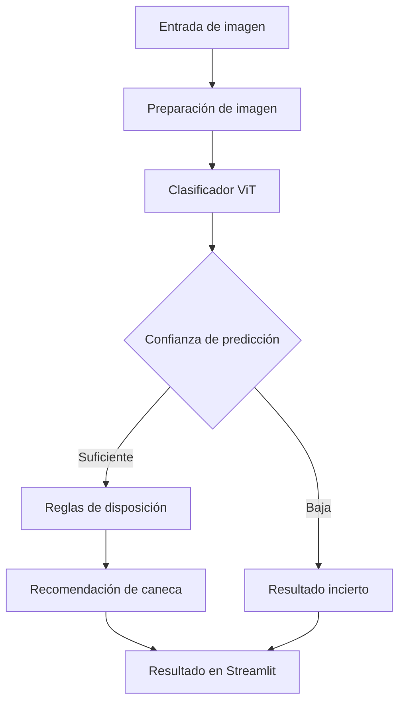
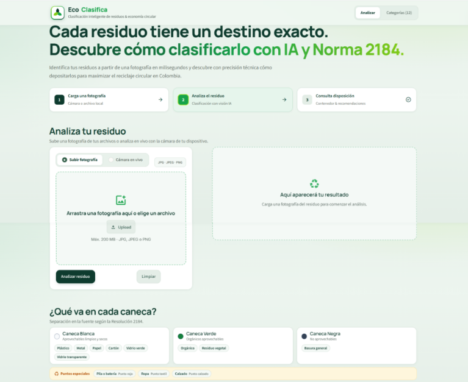
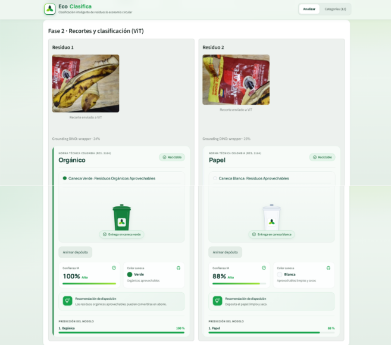
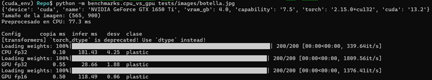

 <div align="center">


# EcoClasifica ♻️

**Identifica tus residuos y descubre cómo separarlos correctamente.**

[](https://www.python.org/)
[](https://streamlit.io/)
[](https://pytorch.org/)
[](https://huggingface.co/)
[](https://developer.nvidia.com/cuda-toolkit)
[](./LICENSE)

</div>

---

##  Descripción

**EcoClasifica** es una aplicación desarrollada en Python y Streamlit que utiliza inteligencia artificial y visión por computador para identificar residuos a partir de imágenes y recomendar su correcta separación.

Su propósito es facilitar la clasificación de residuos, indicando si deben depositarse en una caneca blanca, verde, negra o llevarse a un punto de recolección especial.

El proyecto utiliza modelos preentrenados y permite aprovechar la GPU NVIDIA mediante CUDA cuando está disponible.

##  Funcionalidades

| Funcionalidad | Descripción |
|---|---|
| Carga de imágenes | Permite seleccionar una imagen para analizarla. |
| Clasificación automática | Identifica el residuo entre 12 categorías. |
| Nivel de confianza | Presenta las predicciones y sus puntuaciones. |
| Recomendación | Indica la caneca o el punto de recolección correspondiente. |
| Catálogo visual | Muestra las categorías reconocidas y su disposición. |
| Procesamiento con GPU | Utiliza CUDA cuando el dispositivo es compatible. |

##  ¿Cómo funciona?

El sistema recibe una imagen y la procesa mediante el clasificador de residuos. Posteriormente, relaciona la categoría obtenida con las reglas de disposición definidas en el proyecto.



El sistema contempla estados para imágenes que no corresponden a residuos y predicciones con confianza insuficiente, según los umbrales configurados en el proyecto.

##  Modelo de inteligencia artificial

### Clasificador de residuos — Vision Transformer (ViT)

Modelo utilizado: [`watersplash/waste-classification`](https://huggingface.co/watersplash/waste-classification).

Es un modelo preentrenado de clasificación de imágenes basado en la arquitectura Vision Transformer (ViT), ajustado para reconocer diferentes tipos de residuos.

| Característica | Información |
|---|---|
| Arquitectura | Vision Transformer (ViT) |
| Tarea | Clasificación de imágenes |
| Parámetros | 85,8 millones |
| Tipo de pesos | F32 |
| Categorías | 12 |
| Precisión de ejecución | FP32 |
| Resolución de entrada | 224 × 224 píxeles |
| Dataset | [Garbage Classification](https://www.kaggle.com/datasets/mostafaabla/garbage-classification) |

El modelo recibe la imagen, extrae sus características visuales y genera puntuaciones para las categorías aprendidas durante su entrenamiento. En EcoClasifica se conservan las tres predicciones principales y se aplica un umbral de confianza para determinar el resultado.

**Importante:** el modelo no fue entrenado desde cero por el equipo. Se utiliza el modelo preentrenado disponible en Hugging Face.

##  Categorías reconocidas

El clasificador contempla 12 categorías, relacionadas con las reglas de disposición implementadas en EcoClasifica.

| Categoría | Etiqueta del modelo | Destino |
|---|---|---|
| Plástico | `Plastic` | Caneca blanca |
| Metal | `Metal` | Caneca blanca |
| Papel | `Paper` | Caneca blanca |
| Cartón | `Cardboard` | Caneca blanca |
| Vidrio verde | `Green-Glass` | Caneca blanca |
| Vidrio transparente | `White-Glass` | Caneca blanca |
| Orgánico | `Biological` | Caneca verde |
| Residuo vegetal | `Brown-grass` | Caneca verde |
| Basura general | `Trash` | Caneca negra |
| Pila o batería | `Battery` | Punto de recolección especial |
| Ropa | `Clothes` | Punto de recolección especial |
| Calzado | `Shoes` | Punto de recolección especial |

La asignación de los residuos sigue las reglas de separación en la fuente utilizadas en Colombia y las reglas configuradas en el proyecto.

## Interfaz de usuario

La aplicación cuenta con una interfaz desarrollada en Streamlit, organizada mediante componentes reutilizables y estilos personalizados.

Entre sus elementos se encuentran:

- Encabezado y presentación del proyecto.
- Área de carga y visualización de imágenes.
- Panel de resultados de clasificación.
- Catálogo visual de las 12 categorías.
- Recomendaciones de disposición.
- Animación de la caneca correspondiente al resultado.

**Vista principal**

<!-- Agregar captura real de la aplicación -->
<p align="center">
  
</p>

**Resultado de clasificación**

<!-- Agregar captura real de una clasificación -->
<p align="center">
  
</p>

##  Tecnologías utilizadas

| Tecnología | Aplicación en el proyecto |
|---|---|
| Python | Lenguaje principal |
| Streamlit | Interfaz de usuario |
| PyTorch | Ejecución del modelo |
| Hugging Face Transformers | Carga del clasificador ViT |
| CUDA | Aceleración mediante GPU NVIDIA |
| Git y GitHub | Control de versiones y colaboración |

##  Instalación y ejecución

### Requisitos

- Python 3.x.
- Git.
- Dependencias del archivo `requirements.txt`.
- GPU NVIDIA compatible con CUDA (opcional).

### 1. Clonar el repositorio

```bash
git clone URL_DEL_REPOSITORIO
cd reciclador-residuos
```

### 2. Crear un entorno virtual

```bash
python -m venv venv
```

En Windows:

```bash
venv\Scripts\activate
```

En Linux:

```bash
source venv/bin/activate
```

### 3. Instalar las dependencias

```bash
pip install -r requirements.txt
```

### 4. Ejecutar la aplicación

```bash
streamlit run app.py
```

Streamlit abrirá la aplicación en el navegador mediante la dirección local indicada en la terminal.

##  Procesamiento con CUDA

EcoClasifica utiliza PyTorch para ejecutar el clasificador y seleccionar automáticamente el dispositivo disponible: CPU o GPU NVIDIA.

Las pruebas de rendimiento se realizaron con una NVIDIA GeForce GTX 1650 Ti de 4 GB de memoria.

### Comparación del clasificador ViT

Prueba realizada con una imagen de 1200 × 1200 píxeles, 30 repeticiones y 5 ejecuciones de calentamiento descartadas.

| Configuración | Tiempo de inferencia |
|---|---:|
| CPU FP32 | 178,60 ms |
| GPU FP32 | 28,61 ms |
| GPU FP16 | 118,52 ms |

La GPU en FP32 fue aproximadamente **6,2 veces más rápida que la CPU** en esta prueba.

La precisión FP16 fue descartada porque presentó un tiempo de inferencia mayor que FP32 en la GPU utilizada.

### Comparación del pipeline completo

En una prueba experimental anterior, el pipeline que incluía un filtro CLIP y el clasificador ViT obtuvo los siguientes resultados:

| Configuración | Tiempo total |
|---|---:|
| CPU FP32 | 328,09 ms |
| GPU FP32 | 73,52 ms |

La GPU fue aproximadamente **4,5 veces más rápida** en esa ejecución.

> Esta medición corresponde a una versión experimental anterior que incluía CLIP. No representa el rendimiento de la arquitectura final sin ese componente.

### Evidencia de GPU

Durante las pruebas del clasificador se registraron los siguientes valores mediante `nvidia-smi`:

| Estado | Uso de GPU | Memoria utilizada | Temperatura |
|---|---:|---:|---:|
| Reposo | 0 % | 0 MiB | 44 °C |
| Inferencia | 97 % | 463 MiB | 56 °C |

<!-- Agregar capturas reales de docs/evidence -->
<p align="center">
  
</p>

##  Estructura del proyecto

```text
reciclador-residuos/
│
├── app.py
├── requirements.txt
├── README.md
├── LICENSE
│
├── assets/
│   └── categorias/
│
├── ui/
│   ├── components.py
│   └── theme.css
│
├── src/
│   ├── models/
│   │   ├── gate.py
│   │   └── waste_classifier.py
│   │
│   ├── config.py
│   ├── contracts.py
│   ├── device.py
│   ├── pipeline.py
│   └── recycling_rules.py
│
├── benchmarks/
│
├── tests/
│
└── docs/
    ├── cuda_log.md
    └── evidence/
```

##  Limitaciones y trabajo futuro

- La clasificación depende de la calidad, iluminación y posición del objeto en la imagen.
- La confianza del modelo no garantiza que una predicción sea correcta.
- El modelo puede presentar errores con objetos o escenarios diferentes a los de sus datos de entrenamiento.
- La detección de múltiples objetos mediante YOLO y su integración con la clasificación se encuentran pendientes de definir.
- La entrada de cámara en tiempo real y la clasificación continua de objetos no se presentan como funcionalidades disponibles en esta versión.

##  Equipo de desarrollo

| Integrante | Responsabilidad |
|---|---|
| Aura | Modelos de inteligencia artificial y reglas de clasificación |
| Javier | Integración del pipeline, contratos y pruebas |
| Felipe | CUDA, selección del dispositivo y benchmarks |
| Viviana | Interfaz de usuario, experiencia de usuario y documentación |

Proyecto desarrollado en el marco de la asignatura **Fundamentos de Computación Paralela y Distribuida**.

##  Licencia y referencias

El código del proyecto se distribuye bajo la licencia [MIT](./LICENSE).

La licencia del modelo preentrenado debe consultarse por separado en su ficha de Hugging Face.

- [Modelo de clasificación — Hugging Face](https://huggingface.co/watersplash/waste-classification)
- [Dataset Garbage Classification — Kaggle](https://www.kaggle.com/datasets/mostafaabla/garbage-classification)
- [Documentación de PyTorch](https://pytorch.org/docs/)
- [Documentación de Streamlit](https://docs.streamlit.io/)
- [Documentación de CUDA](https://docs.nvidia.com/cuda/)

---

<p align="center">
   <strong>EcoClasifica — Una mejor separación comienza con identificar correctamente.</strong>
</p>